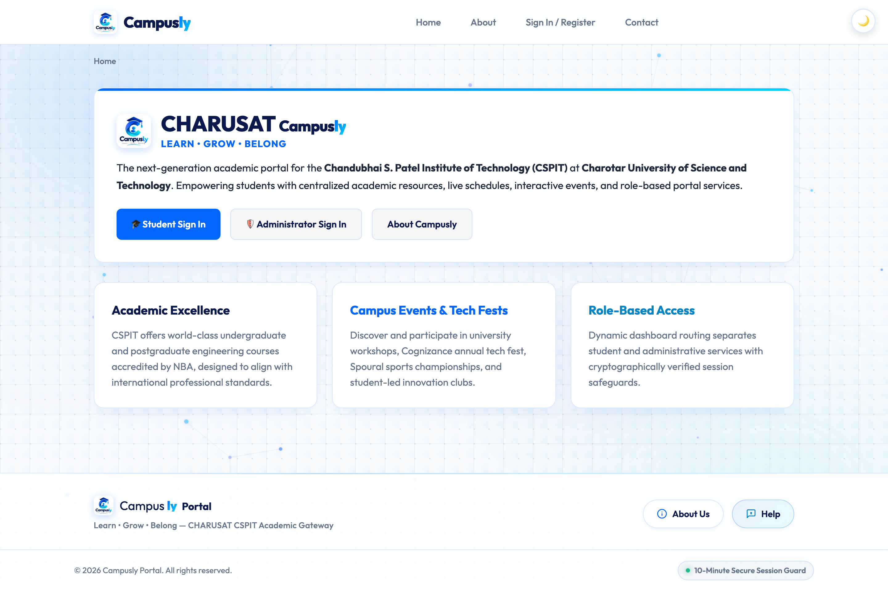

# 🎓 Campusly &mdash; Student Academic Portal

<p align="center">
  
</p>

<p align="center">
  <strong>Learn &bull; Grow &bull; Belong</strong><br>
  <em>A unified academic portal built for Chandubhai S. Patel Institute of Technology (CSPIT), CHARUSAT</em><br>
  <strong>Developer:</strong> Jay Navadiya | <strong>ID:</strong> 25CS052 | <strong>Branch:</strong> B.Tech Computer Science & Engineering
</p>

<p align="center">
  
  
  
  
  
</p>

<p align="center">
  <a href="images/preview.png" target="_blank" rel="noopener noreferrer">
    
  </a>
</p>

---

## 📌 About The Project

Hey there! 👋 **Campusly** is a full-stack college portal I created to bring everyday campus tools together into one simple, unified place. Instead of jumping across different noticeboards, schedules, and spreadsheets, students and faculty can access everything from a clean, intuitive dashboard.

The entire platform is built with core **PHP**, **MySQL**, and vanilla **JavaScript** &mdash; completely free of heavy frameworks or external dependencies. It is fast, lightweight, and easy to run locally or host on any standard web server.

### ✨ What It Can Do
- 🔐 **Dual Role Access:** Separate portals for Students and Admins, protected by secure password hashing (Bcrypt) and an automatic 10-minute inactivity logout.
- ⚡ **Real-Time Student Management:** Add, update, and search student records live using Fetch API / AJAX without page reloads.
- 📅 **Campus Events & Posters:** Browse upcoming hackathons and workshops, register with a single click, and upload event posters.
- 📚 **Academics at a Glance:** Access weekly class timetables, syllabus downloads, and study materials anytime.
- 🗄️ **Clean Database Design:** Structured in 3NF with MySQL foreign keys, prepared statements to prevent SQL injection, and an audit trail for security.
- 📱 **Clean Responsive UI:** Works smoothly on desktop and mobile with comfortable light styling and accessible typography.

---

## 🔗 Key Project Files

| File | Description |
|---|---|
| [`studenthub.sql`](studenthub.sql) | Full MySQL database dump (3NF schema with foreign keys and seed data) |
| [`schema.sql`](schema.sql) | Clean schema definition script for setting up tables |
| [`TEST_AND_SECURITY_REPORT.md`](TEST_AND_SECURITY_REPORT.md) | Full testing checklist, security audit, and accessibility notes |
| [`apache_studenthub_vhost.conf`](apache_studenthub_vhost.conf) | Virtual Host configuration for `http://studenthub.local` |

---

## 🔑 Pre-Configured Test Accounts

| Account Name | Role | Email | Password | Access Level |
|---|---|---|---|---|
| **Administrator** | Admin | `admin@campusly.com` | `Admin@123` | Executive Admin Control Center, User Status Toggle, Audit Logs |
| **Jay Navadiya** | Student | `jay@campusly.com` | `Student@123` | Student Dashboard, Enrolled Courses, Event Registrations |
| **Jash Patel** | Student | `student@campusly.com` | `Student@123` | Student Dashboard & Academic Materials |
| **Bhavy Gol** | Student | `bhavy@campusly.com` | `Student@123` | Student Academic View |

*Users can log in using either their username (`admin`, `jay`, `student`) or their full email address.*

---

## 📂 Project Structure

```
├── README.md                      # Comprehensive Project Documentation
├── TEST_AND_SECURITY_REPORT.md    # Testing, Security & Accessibility Checklist
├── studenthub.sql                 # Complete MySQL 3NF Database Dump
├── schema.sql                     # Relational 3NF SQL Schema & Seed Script
├── apache_studenthub_vhost.conf   # Apache Virtual Host Configuration
├── Open_Campusly.command          # macOS One-Click Launch Script
│
├── index.php                      # Portal Home & Module Gateway
├── login.php                      # Authentication Gateway (Student & Admin Tabs)
├── register.php                   # Student Self-Registration with Validation
├── logout.php                     # Secure Session Termination & Cookie Clearing
├── auth.php                       # Authentication Guard, RBAC Engine & Audit Logger
├── auth_ping.php                  # Session Keep-Alive Endpoint
├── authenticate.php               # Login Request Processor
├── db.php                         # Resilient MySQLi & PDO Connection Handler
│
├── dashboard.php                  # Executive Admin Control Center & Analytics
├── admin_dashboard.php            # Admin Dashboard Router & RBAC Protection Wrapper
├── student_dashboard.php          # Personalized Student Portal & Enrolled Modules
├── students.php                   # Student Directory with Real-time AJAX CRUD & Filtering
├── api.php                        # RESTful JSON API Endpoints for CRUD Operations
├── events.php                     # Campus Events Catalog & Junction Registrations
├── timetable.php                  # Weekly Academic Class Schedule
├── material.php                   # Course Syllabus & Resource Downloads
├── profile.php                    # User Profile & Account Settings
├── about.php                      # About CSPIT, CDPC Placements & CIVF Incubation
├── contact.php                    # Campus Support & Help Desk
├── timeout.php                    # Session Inactivity Timeout View
│
├── index.html                     # Single-Page Application (SPA) Interface
├── script.js                      # Native Fetch API Engine for SPA CRUD
├── style.css                      # Clean White-Themed Component Stylesheet
│
├── css/
│   ├── styles.css                 # Unified Portal CSS, Responsive Grids & Theme
│   └── logo.png                   # Portal Icon Asset
├── js/
│   ├── auth.js                    # Inactivity Timer & Session Warning Modal
│   ├── intro.js                   # Cinematic Monogram Preloader Sequence
│   └── live-bg.js                 # 60 FPS Constellation Particle Engine
├── images/
│   ├── campusly-logo.png          # Official StudentHub Brand Mark
│   ├── campusly-logo.jpg          # Brand Poster Image
│   └── favicon.png                # Browser Favicon
├── includes/
│   ├── header.php                 # Dynamic Navbar, Role Badges & Session Timer
│   └── footer.php                 # Two-Pill Footer (About Us & Help Center)
├── uploads/
│   ├── .htaccess                  # Directory Guard (Script Execution Disabled)
│   ├── index.html                 # Direct Browsing Protection Guard
│   └── posters/                   # Validated Event Poster Image Assets
└── data/                          # Seed JSON Datasets (Events, FAQs, Students)
```

---

## ⚙️ Installation & Setup Instructions

### Option A: Quick Start via PHP Built-in Server (Recommended for Fast Testing)

1. **Clone the Repository**:
   ```bash
   git clone git@github.com:jaynavadiya07/Campusly.git
   cd Campusly
   ```

2. **Import Database Dump**:
   ```bash
   mysql -u root -p < studenthub.sql
   ```
   *This automatically creates the `studenthub` database with all tables, keys, and test data.*

3. **Start the Local PHP Server**:
   ```bash
   php -S 127.0.0.1:8000
   ```

4. **Access the Application**:
   Open [http://127.0.0.1:8000](http://127.0.0.1:8000) in your web browser.

---

### Option B: Local Deployment with Apache Virtual Host (Intermediate Extension)

To deploy locally using Apache (macOS Apache or Windows XAMPP) under the custom domain `http://studenthub.local`:

1. **Include Virtual Host Configuration**:
   Copy the virtual host configuration from [`apache_studenthub_vhost.conf`](apache_studenthub_vhost.conf) into your Apache configuration:
   - **macOS Apache:** `/etc/apache2/extra/httpd-vhosts.conf` or `/opt/homebrew/etc/httpd/extra/httpd-vhosts.conf`
   - **Windows XAMPP:** `C:\xampp\apache\conf\extra\httpd-vhosts.conf`

   ```apache
   <VirtualHost *:80>
       ServerAdmin admin@studenthub.local
       ServerName studenthub.local
       ServerAlias www.studenthub.local
       DocumentRoot "/Users/jaynavadiya07/Desktop/Project"
       <Directory "/Users/jaynavadiya07/Desktop/Project">
           Options -Indexes +FollowSymLinks
           AllowOverride All
           Require all granted
           DirectoryIndex index.php index.html
       </Directory>
       ErrorLog "/private/var/log/apache2/studenthub_error.log"
       CustomLog "/private/var/log/apache2/studenthub_access.log" combined
   </VirtualHost>
   ```

2. **Update Local DNS (`hosts` file)**:
   Add the domain resolution entry:
   - **macOS / Linux:** `sudo nano /etc/hosts`
   - **Windows:** Open `C:\Windows\System32\drivers\etc\hosts` as Administrator.
   
   Add line:
   ```text
   127.0.0.1 studenthub.local
   ```

3. **Restart Apache Server**:
   - **macOS:** `sudo apachectl restart`
   - **XAMPP:** Click **Stop** then **Start** on the Apache service in the XAMPP Control Panel.

4. **Open Portal**:
   Navigate to [http://studenthub.local](http://studenthub.local).

---

### Option C: Online / Cloud Deployment Architecture (Advanced Extension)

For production deployment to cloud infrastructure:
1. **Frontend / Static Layer**: Can be decoupled and distributed across edge CDNs (Vercel, Netlify, Cloudflare Pages) for near-zero latency.
2. **Backend PHP Engine**: Deployable to any standard Linux container PaaS (Railway, Render, Fly.io, or cPanel/LAMP shared hosting).
3. **Database Layer**: Managed MySQL instance (AWS RDS, PlanetScale, or Aiven MySQL) connected via environment variables (`DB_HOST`, `DB_USER`, `DB_PASS`, `DB_NAME`).

---

## 🧪 Testing Guide

1. **Verify Home & Navigation**:
   Open [http://127.0.0.1:8000/index.php](http://127.0.0.1:8000/index.php). Verify all navigation links, theme toggle, and hero buttons function properly.
2. **Test Administrator Authentication**:
   Log in with `admin@campusly.com` / `Admin@123`. Observe executive dashboard with live KPIs, dynamic registration analytics, and user status toggling.
3. **Test Student Authentication & RBAC**:
   Log out and log in with `jay@campusly.com` / `Student@123`. Observe student portal with personal enrolled subjects.
4. **Test RBAC 403 Security Interception**:
   While logged in as a student, navigate directly to `http://127.0.0.1:8000/dashboard.php`. Confirm HTTP 403 Access Denied warning is displayed and violation is logged.
5. **Test AJAX CRUD (No Reload)**:
   Navigate to `students.php`. Add a student via modal, search dynamically with instant keystroke debounce, and export CSV.
6. **Test 10-Minute Session Timeout**:
   Observe session countdown timer in the top-right header. Warning modal triggers at 1 minute remaining.

---

<p align="center">
  &copy; 2026 StudentHub (Campusly) &bull; Chandubhai S. Patel Institute of Technology (CSPIT), CHARUSAT.
</p>
